<div align="center">

<picture>
  <source media="(prefers-color-scheme: dark)" srcset="public/brand/snapstart-logo-light.png">
  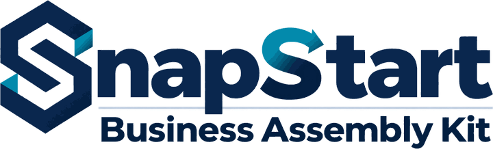
</picture>

### From “I have an idea” to a business that's legally set up, branded and selling.

There are tools for forming a company, like LegalZoom, and tools for building a website, like Wix. SnapStart does both, plus the marketing plan, social media setup, ads, and managing products and sales. **It's the one guided kit that takes an owner from the idea on day one to their first sale.**

SnapStart is a startup kit that tailors itself to the user's actual business. It finds the exact licenses, permits and registrations that apply to *their* business in *their* city, county and state, quoting the official government pages. It recommends the right structure, fills in the official forms, and builds their logo, brand photos and website. **Meta Muse reads, writes and draws, SnapStart's tested code checks every fact, and the owner always knows what to do next.**

**[Try the live demo →](https://snapstartkit.vercel.app/demo)**


<br>


<br>

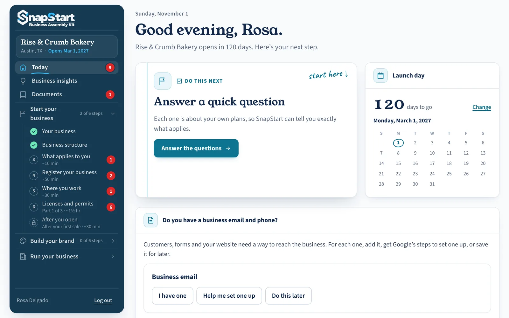

</div>

---

## Contents

- [Why SnapStart](#why-snapstart)
- [Tailored to your business](#tailored-to-your-business)
- [At a glance](#at-a-glance)
- [Feature tour](#feature-tour)
- [Made with Meta Muse](#made-with-meta-muse)
- [How the AI is built](#how-the-ai-is-built)
- [Architecture](#architecture)
- [Safety and trust](#safety-and-trust)
- [Tech stack](#tech-stack)
- [Testing and the AI benchmark](#testing-and-the-ai-benchmark)
- [Getting started](#getting-started)
- [Deploying](#deploying)
- [Coming soon](#coming-soon)


---

## Why SnapStart

Every new business in the US has rules to follow from the federal government, the state, the county and the city, and nobody hands the owner the list. A home baker in Austin has to work out whether Texas's cottage food law covers their kitchen, whether Austin's zoning lets customers pick up at the door, whether to form an LLC, which form does that, what it costs, and where to send it. The answers are scattered across dozens of official sites, written for lawyers. Most first-time owners either pay someone to sort it out or guess, and a wrong guess can mean fines or a business that never opens.

**SnapStart is built for that owner**: the person starting something for the first time, before they can hire help. A daughter opening a bakery, two brothers selling wooden housewares, a friend dreaming of a boutique. It gives them clear answers grounded in official sources, the paperwork ready to sign, and a brand and website to sell with, all in one guided place.

It works by a simple split:

| | Who does it | Examples |
|---|---|---|
| **AI drafts** | Meta Muse | Reads official pages and quotes them, explains a form in plain words, drafts website copy, designs logos, makes brand and product photos, writes a marketing plan |
| **SnapStart's code checks and calculates** | Plain, unit-tested TypeScript | Which requirements apply, the order of steps, fees and totals, stock and margins, form answers, every quality check |
| **The owner approves** | The person | They review each draft, then sign, file and publish on their own terms |

## Tailored to your business

Every owner gets a plan built for their business, not a generic checklist. Here's what SnapStart does with a few clicks of intake answers:

- **Finds the legal requirements that apply to you.** SnapStart finds the official sites of your city, county, state and the federal government, Muse Spark reads the pages, and SnapStart confirms every quote against the page before showing the exact lines that apply to your business: a cottage food exemption for a home baker, a food handler card for a food truck, a sales tax permit for anyone selling goods, an assumed name filing when you sell under a brand name.
- **Sorts what applies from what doesn't.** SnapStart's code checks each requirement against your answers (where you work, what you sell, who helps you, how customers buy) and turns it into "applies", "doesn't apply" or one short question about your plans.
- **Digs deeper on open questions.** When a page doesn't settle something, SnapStart looks through the office's own site, code and forms, then explains the answer in plain words. Anything still open becomes a ready-to-send message to the right office, with its email and phone.
- **Recommends a structure for you.** SnapStart weighs everything you've told it (partners, risk, plans to hire, how you'll be paid) and explains why a sole proprietorship, LLC or partnership fits, citing IRS and SBA guidance.
- **Fills in your paperwork.** SnapStart fills in official forms like IRS Form SS-4 and Texas Form 205 from your saved details, then shows exactly where to sign and send it.
- **Builds your brand from your own words.** Your answers become a brand story and taglines that name what you actually sell. Muse Image draws logo ideas; SnapStart cuts the logo versions from its pixels and makes brand and product photos sized for each platform, with your logo in the scene.
- **Knows your market.** SnapStart drafts website copy from your real products and prices, checking every price claim in code, compares prices for similar products and services near you with links to each one, and writes a marketing plan for the platforms you chose.

## At a glance

SnapStart is a guided workspace in three parts, and a **Today** page always shows the one next step.

<table>
  <tr>
    <th width="33%">1 · Start your business</th>
    <th width="33%">2 · Build your brand</th>
    <th width="33%">3 · Run your business</th>
  </tr>
  <tr>
    <td align="center">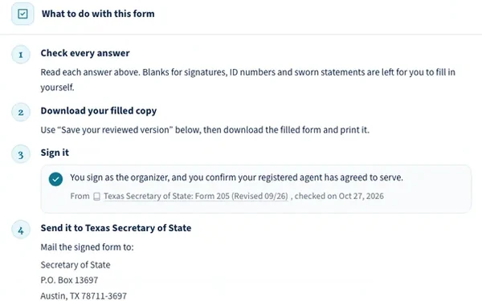</td>
    <td align="center"></td>
    <td align="center">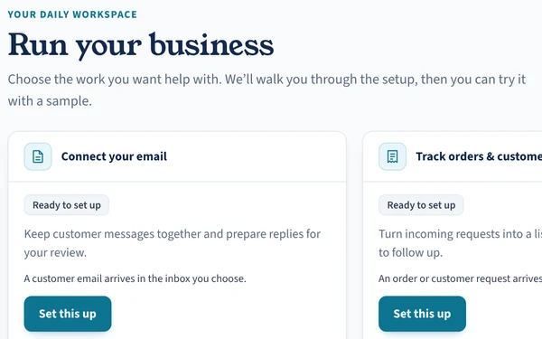</td>
  </tr>
  <tr>
    <td valign="top"><b>Know exactly what your business needs.</b><br><br>
      • Researches the legal requirements for your exact city, county and state on official .gov sites, with quotes<br>
      • Recommends a structure (LLC, sole proprietorship, DBA, taxes) from your answers<br>
      • Fills in official forms like IRS SS-4 and Texas Form 205 for you to sign<br>
      • Turns it all into an ordered plan with fees and renewals</td>
    <td valign="top"><b>Look like a real business on day one.</b><br><br>
      • Logos drawn by Muse Image, with stacked, icon and one-color versions cut from the logo's own pixels<br>
      • Brand photos with your logo printed into the scene<br>
      • A website built from your products, checked against your prices<br>
      • Prices from similar businesses near you</td>
    <td valign="top"><b>Keep the day-to-day in one place.</b><br><br>
      • Customer email, turned into orders and replies (coming soon, with a working demo to try now)<br>
      • Order and job tracking with due dates, payments and balances<br>
      • Friendly business insights with tips you can act on<br>
      • Every form, receipt and approval in one document library</td>
  </tr>
</table>

## Feature tour

### Today: the next step, every day


Today greets the owner with the one thing to do next, a countdown to launch day, and how far they've come in each part. The recording at the top of this page is Today for Hearth & Wick Candle Co., a candle studio in Austin.

### Your business: a click-based intake


Owners answer mostly by clicking. A home baker, a woodworker and a dog groomer each get the follow-ups that matter for them (food kept cold, items for children, where the work happens). "Not sure" is a welcome answer: SnapStart keeps it as an open question and helps the owner find out. County and city come from Census Bureau lists, progress saves as you go, and the owner confirms a summary before any research starts.

<p align="center">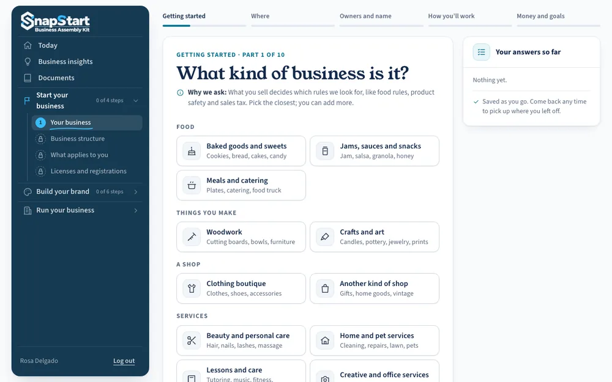</p>

### Business structure: four decisions, explained one at a time


Ownership structure, business name (DBA), tax treatment and licenses are four different decisions, and the page walks through each one. SnapStart weighs everything the owner has said and recommends a starting point, citing verbatim IRS and SBA guidance. The owner records their choice with a dated history, and the plan updates to match.

<p align="center">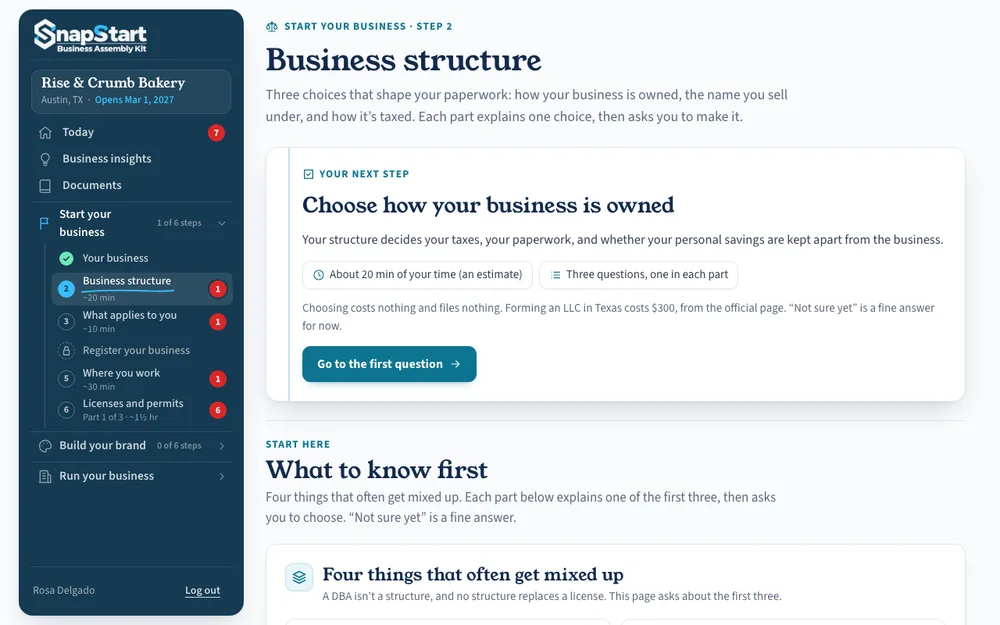</p>

### What applies to you: research grounded in official sources


SnapStart finds the official government websites for the owner's city, county and state, plus the federal government. A site counts as official only when it's listed in CISA's .gov registry, so every official source is a real government site; anything else is marked for the owner to check. Muse Spark reads those pages and pulls out each legal requirement with a word-for-word quote, and SnapStart confirms the quote is really on the page, so the owner can see exactly where it came from and which government it belongs to. SnapStart then checks each requirement against the owner's answers to show what applies to them.

<p align="center">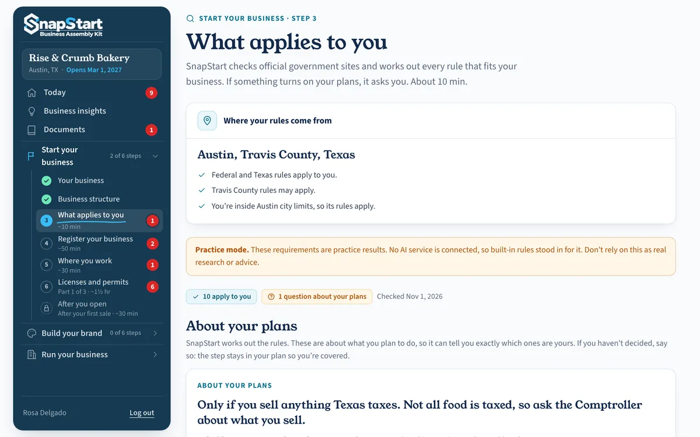</p>

### Paperwork: the official form, filled in and ready to sign


Each step comes with numbered instructions, and every fee and method links to the official page with the date it was checked. "What to do with this form" then explains how to sign it, where to send it and how to record it. Each part of the paperwork (registering the business, tax IDs, where you work, licenses and permits) has its own menu entry with the time it takes.

<p align="center">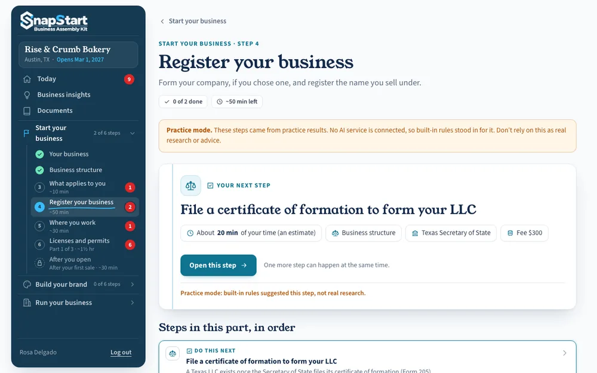</p>

### Owners' agreement


For an LLC or a partnership, SnapStart prepares the owners' agreement when required by the user's state, using carefully written standard wording filled in with the owners, their shares, what each puts in and how they'll make decisions. It's saved as a PDF with a signature line for each owner, ready to sign and keep with the business records.

### Documents: every business record in one place


Documents is the business's filing cabinet. Everything SnapStart prepares lands here: the filled-in official forms, the owners' agreement, the business plan, and each receipt and approval. Owners add their own files too, from a photo of a letter to a PDF from the state. Downloaded originals stay untouched; each reviewed copy, receipt and approval is kept as its own version next to the original.

Got a letter and not sure what it means? Add it, and SnapStart explains what it is, who sent it and what to do next, like a deadline or a fee, quoting the document's own words. For a form to fill in, owners can ask about any field, and SnapStart drafts the answers from their saved details for them to review.

<p align="center">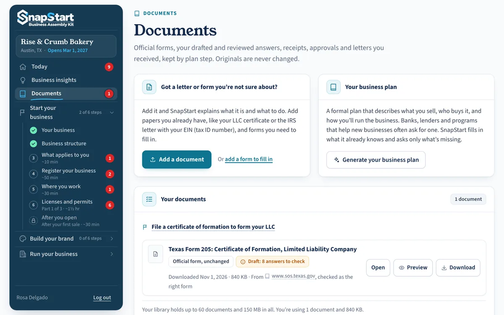</p>

### Business insights


Business insights gives owners friendly, specific feedback and tips on their idea, with a link to where they can act on each one. SnapStart reads the whole picture (the answers, plan, brand, website and products) and highlights what's strong, what to keep an eye on, and creative ideas to try. Owners can mark tips as useful, and a refresh notices what's changed since last time.

### Build your brand: feel first, then a logo


Owners click a few feel words, answer some this-or-that questions and pick color families. SnapStart turns those picks into a short brand description the owner approves or rewrites, and it guides every logo idea, version and picture after that. Owners get a full brand without writing a single prompt.

<p align="center">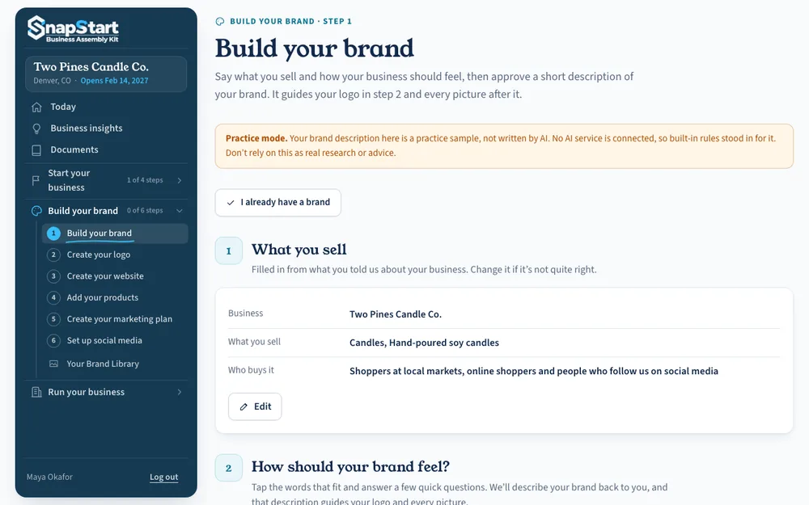</p>

### Logo versions, built from the logo's own pixels


Muse Image draws the logo ideas. From the chosen logo, SnapStart builds the stacked, icon and one-color versions directly from its pixels: it finds the symbol and the lettering with connected-component analysis and rearranges the original artwork, so every version keeps the logo's exact lettering and adds no extra cost. The chosen logo sits on a checkerboard so its see-through background is plain to see, ready to grab with **Download logo (PNG, see-through)** and drop onto any color. The brand kit adds colors with contrast ratings, every logo file size, favicons and social profile pictures, made right in the browser.

<p align="center">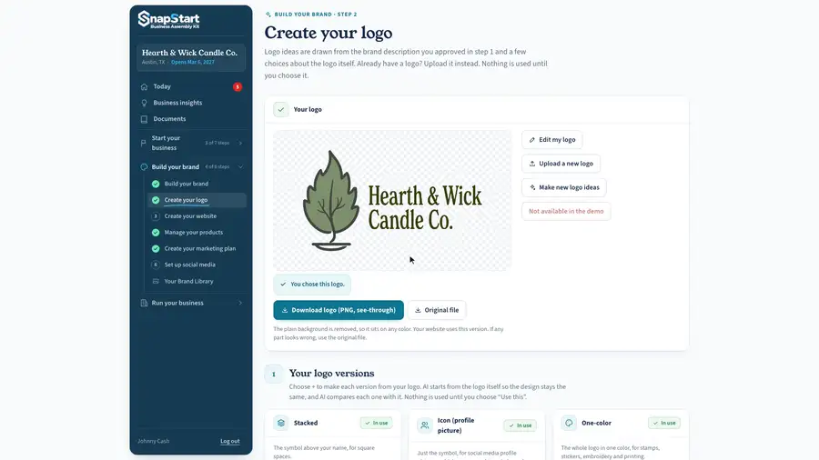</p>

### Website: design it, check it, publish it


Choose a platform and web address in a focused two-step setup, then open the website builder. SnapStart designs the theme from the saved brand brief, palette, audience, lettering and real imagery, and the designs go well beyond a template: split, photo-cover and editorial openings, framed product grids and story bands, with the see-through logo sitting cleanly on any background. Products and photos flow in from the product library, with header images from the Brand Library. Owners click the live page to edit, refine the theme with AI, arrange sections, adjust typography and colors, choose images and manage product details, with undo, redo and saved drafts.

**Publish website** opens a final check: the finished site at computer and phone width, with SnapStart confirming everything is ready. One more step brings up SnapStart web hosting, a simple monthly subscription that puts the site online and keeps it current every time the owner makes a change. Existing Square sites can be connected; Wix and Shopify are marked Coming Soon.

<p align="center">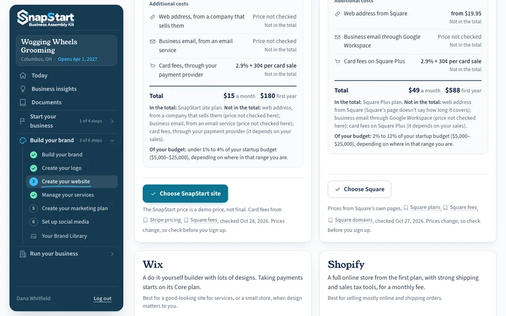</p>

### Products, with options and nearby prices


Products get photos, a price, a cost and stock. Photos are attached as each product is added, so they show up on the website right away. Options like size or scent each carry their own price and stock, and SnapStart works out the price range, totals and how much is left from each sale. Each option, like a 12 oz candle or a large-dog groom, is ordered and counted on its own. "Compare prices near you" uses web search to show what similar items sell for nearby, with a link to each.

<p align="center">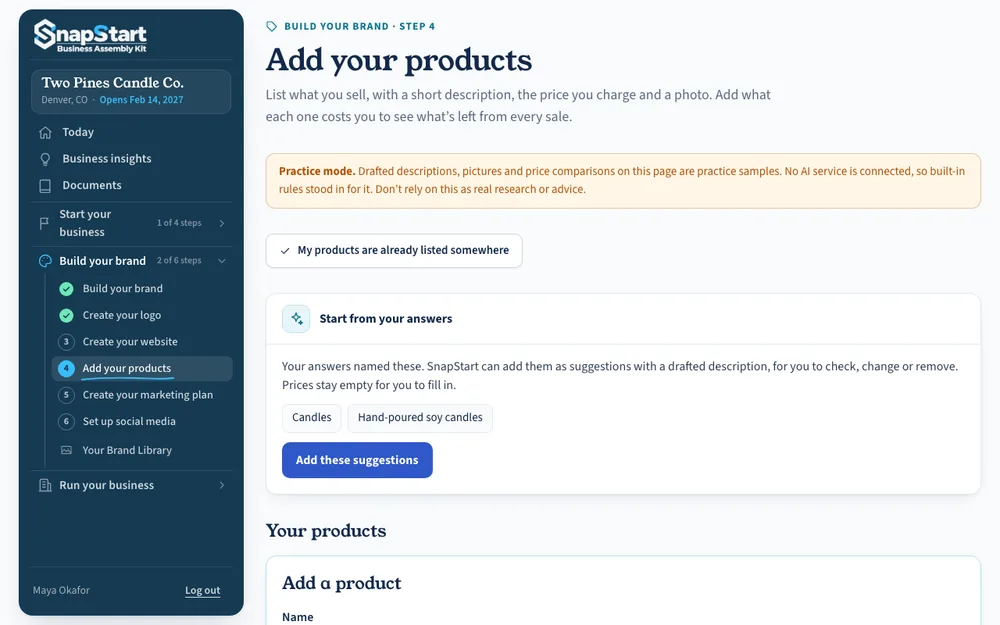</p>

### Connect your Square products

Connect Square to import products, photos, options and selling prices into your SnapStart library. Keep Square products separate from unpublished items, review and publish changes when you're ready, and see when each product was last pushed. For description changes, SnapStart drafts the words, the owner reviews them, and approved updates are validated before being sent to Square.

<p align="center">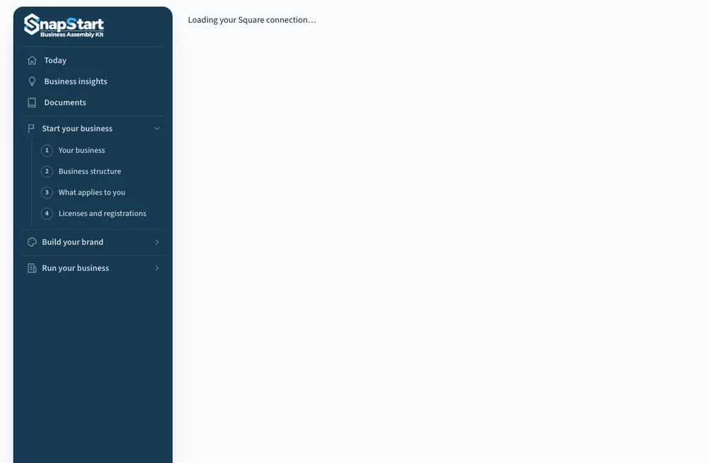</p>

### Services, priced your way


For a service business, the same step becomes **Manage your services**: how each service is priced, how long it takes, where it happens and what's included, with options like dog size carrying their own prices.

<p align="center">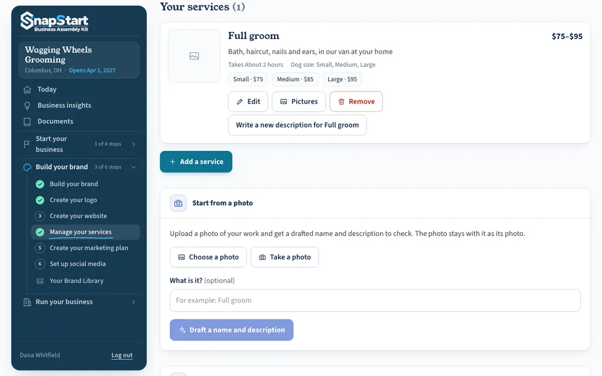</p>

### Product photos


From the products step, owners can turn an ordinary phone photo into a polished store photo. SnapStart checks the photo first and offers retake tips when needed, then edits it using the original as its reference, so the product stays exactly as it is while the background and light change. The two are shown side by side for the owner to approve into their product library.

### Marketing plan


A few quick questions (where the owner wants to show up, how familiar they are with social media, what they've tried) become a marketing plan: goals, who to reach, the platforms that fit, things to post about and a weekly rhythm. Approving it turns the plan into ordered steps, with as much hand-holding as the owner wants.

### Social media


For each platform in the plan, SnapStart gets the account ready: the name, a drafted bio, a profile picture and a cover from the brand kit, plus step-by-step setup that follows each platform's own help pages.

**Post ideas.** A lightbulb at the top of the social media page brings three new ideas every day, made for this business: a local event coming up, a seasonal moment, or something new in the owner's market. Muse searches the web for what's happening near the owner and in their line of work, then writes why each one fits and a ready-to-post caption. Each idea shows what's happening, why it fits, the suggested post with a copy button, and the page it came from. SnapStart's code checks every idea before it shows: it has to come from a page in that day's search, each from a different page, with no prices, discounts or links in the post, and no topic repeated from the past week. Ideas stay the same all day and refresh on the owner's next day, and new ones stay marked until the owner opens them. While the day's ideas are being found, a ring spins around the lightbulb.

<p align="center">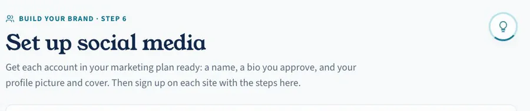</p>

<p align="center">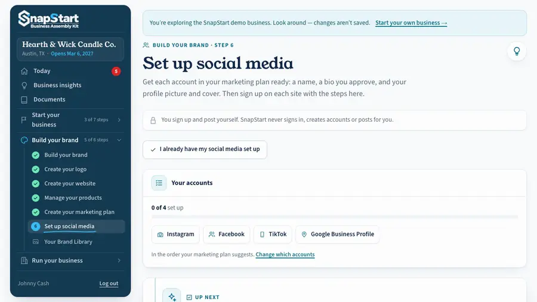</p>

### Your Brand Library


Everything the brand is made of lives in one place: the chosen logo and its versions, brand pictures, product photos and any artwork the owner already had. SnapStart makes each brand picture at the exact size its platform asks for: a website header, Facebook cover, YouTube banner, link preview, Instagram post, Instagram story or reel cover, Facebook ad, flyer picture and product scene. Each one is its own scene in the brand's style, with the logo worked right in.

The library tags every picture with what it's for. Owners filter by purpose, hover a thumbnail for a larger look, and open any picture to see where it's used, its exact size and, with **Show what gets cropped**, the safe area for the logo and anything important. Every picture downloads at its platform's exact size.

<p align="center">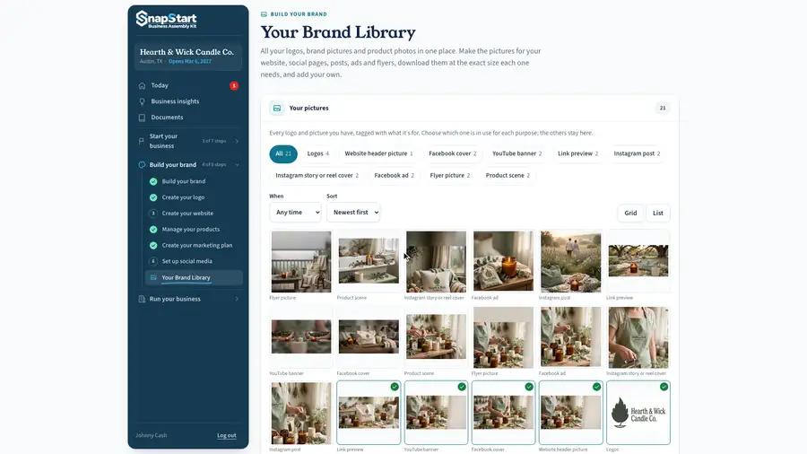</p>

### Run your business

  

Customer email and a shared order/job tracker. Coming soon: connect your business email, press **Read new emails**, and SnapStart turns each customer email into an order, a quote request, a shipping update or a question, with a reply drafted for the owner to send. You can try it today: **Connect your email** opens a working demo with a connected sample inbox (`/email/demo`), where nine bakery emails become orders, quote requests and replies right in the browser, saving nothing. Owners can already upload an invoice, paste an email or enter work themselves. The tracker adapts to products, made-to-order work and services, with due dates, progress, payments and balances; confirming applies catalog prices and takes stock once. Replies are drafted for the owner to edit, then open in the owner's own email app to send.

<p align="center">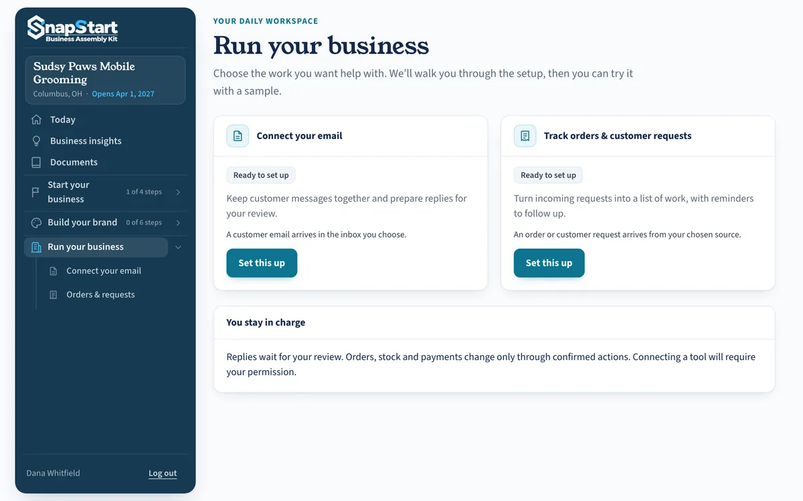</p>

<p align="center">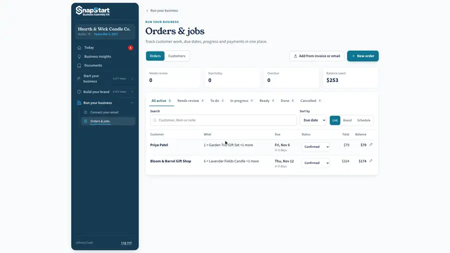</p>

### On a phone

Phones get a bottom tab bar (Today, Setup, Brand, Run, More), large tap targets, and a friendly tip pointing to the tabs.

<p align="center">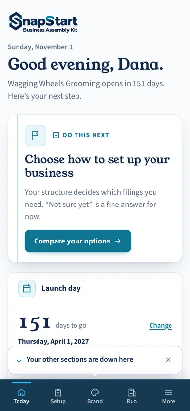</p>

---

## Made with Meta Muse

Everything in this section came straight from **Muse Spark** (text and checks) and **Muse Image** (pictures), through the same code the app uses, in benchmark runs (`npm run bench -- --image-quality --live`). The pictures are shown as they came back.

**Logo ideas.** Muse Spark acts as a creative director and writes distinct concepts; Muse Image draws each one with the name spelled exactly.

<table>
  <tr>
    <td align="center">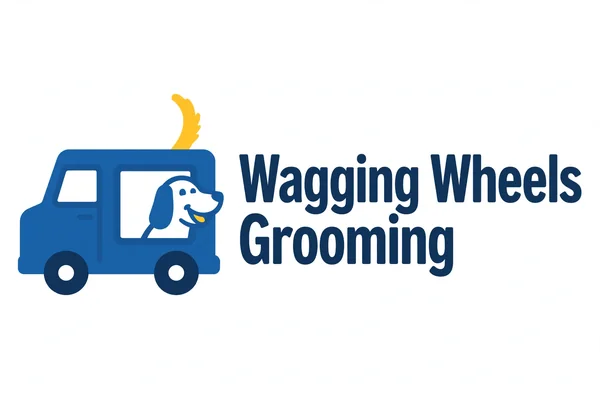<br><sub>Mobile groomer, Columbus OH</sub></td>
    <td align="center">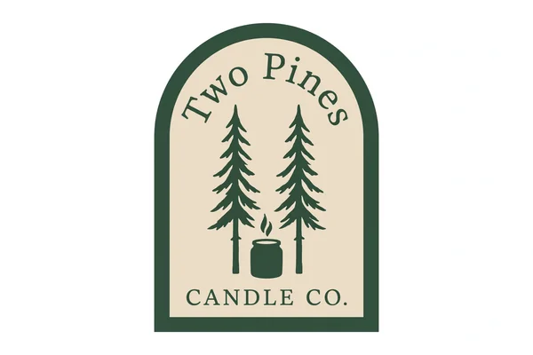<br><sub>Candle maker, Denver CO</sub></td>
  </tr>
  <tr>
    <td align="center">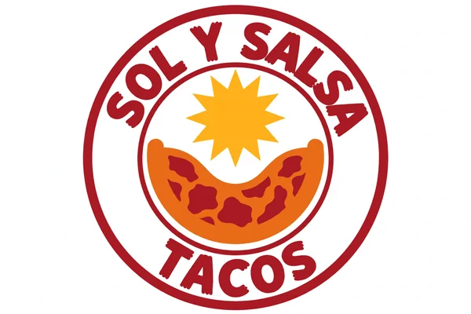<br><sub>Taco truck, Phoenix AZ</sub></td>
    <td align="center">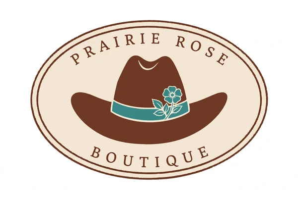<br><sub>Western boutique, Fort Worth TX</sub></td>
  </tr>
</table>

**Versions built from the logo.** SnapStart cuts the symbol and lettering from the logo's own pixels.

<table>
  <tr>
    <td align="center"><br><sub>Original (Muse Image)</sub></td>
    <td align="center"><br><sub>Stacked</sub></td>
    <td align="center">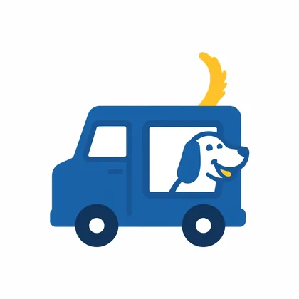<br><sub>Icon</sub></td>
    <td align="center">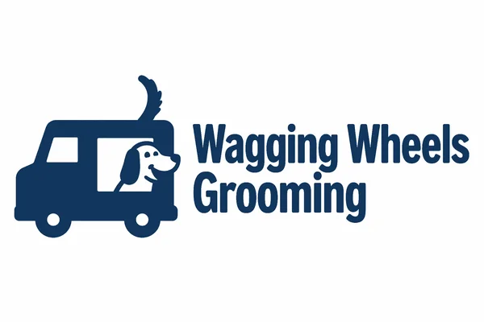<br><sub>One color (#12365D)</sub></td>
  </tr>
</table>

**Brand photos with the logo in the scene.** Muse Image takes the approved logo as a reference image and places it naturally on a banner, a sign or an apron. The website header comes first; once the owner approves it, the other pictures are made to match it as if from the same shoot.

<table>
  <tr>
    <td>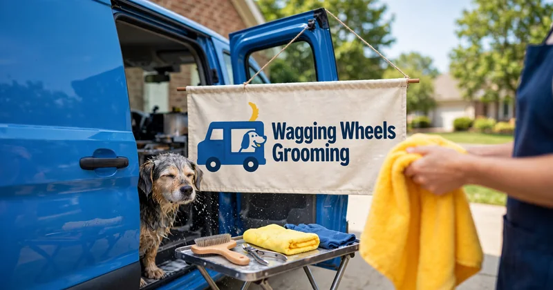</td>
    <td></td>
  </tr>
  <tr>
    <td>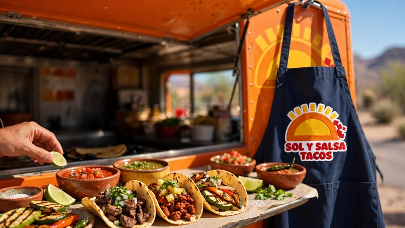</td>
    <td>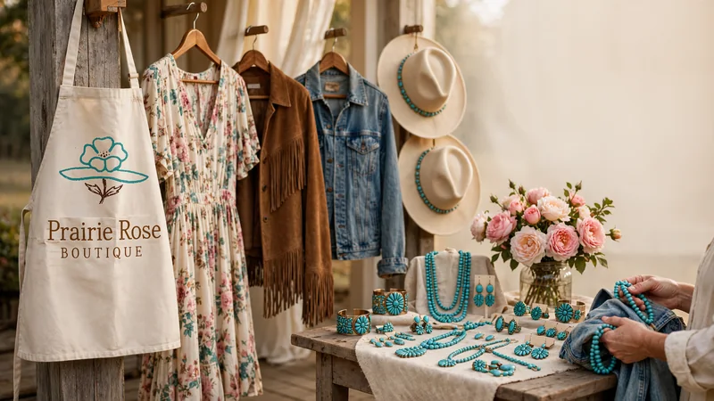</td>
  </tr>
</table>

**Edits in plain words.** The owner describes a change; Muse Image edits the picture with the logo as a second reference, so the brand stays exactly the same. Prompt: *“Make it Christmas themed: a garland with red and gold ornaments, snow falling outside, and red and green accents.”*

<table>
  <tr>
    <td align="center"><br><sub>Before</sub></td>
    <td align="center">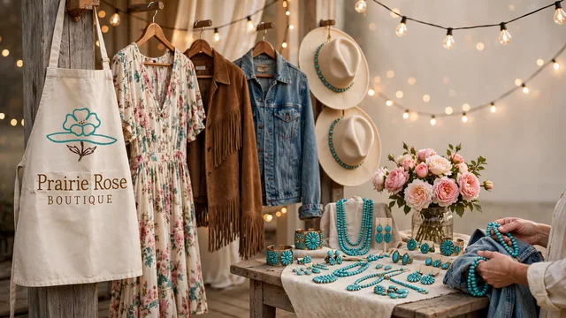<br><sub>After</sub></td>
  </tr>
</table>

**Product photos.** Muse Image turns a casual snapshot into a store photo, using the original as its reference so the product stays identical, and Muse Spark compares the two.

<table>
  <tr>
    <td align="center">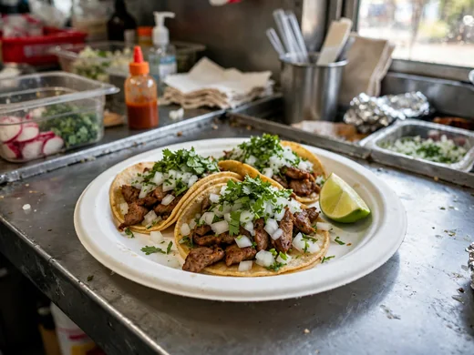<br><sub>Snapshot</sub></td>
    <td align="center">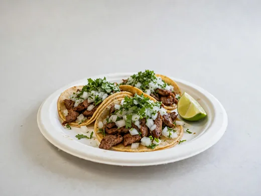<br><sub>Store photo</sub></td>
  </tr>
</table>

---

## How the AI is built

SnapStart is built on **Meta Muse**: **Muse Spark** for text, reasoning and vision, and **Muse Image** for pictures. Having both in one ecosystem means one key, one API style and one set of conventions for everything from reading a state statute page to drawing a logo. The AI layer is also designed so any OpenAI-compatible model can be plugged in with an environment change.

### Where Meta Muse does the work

| Muse capability | What SnapStart uses it for |
|---|---|
| **Muse Spark, structured outputs** | Every AI feature returns JSON that matches a zod schema, sent as `response_format: json_schema`, so replies drop straight into the app. |
| **Muse Spark, reading and reasoning** | Reads official government pages and returns requirements with word-for-word quotes, weighs structure choices, explains forms, drafts business plans, marketing plans and website words. |
| **Muse Spark, vision** | Reads uploaded letters, forms and photos (handwriting and glare included), checks product photos before editing, reads logo lettering to confirm the name is spelled right, and compares edited pictures with the original. |
| **Muse Spark, web search** | Finds the addresses of state, county and city pages, and nearby prices for products. |
| **Muse Image, generation** | Draws logo ideas from a creative brief, flat and clean, with the business name spelled exactly. |
| **Muse Image, editing with reference images** | Product photos, logo edits and brand photos all start from the owner's own images as references, so the product and the logo stay identical while the scene changes. |
| **Prompt caching** | Stable system prompts and a `prompt_cache_key` per task let repeat calls reuse the cache; cached input is $0.15 per million tokens against $1.25. |

Muse's speed keeps the experience conversational: a logo idea or a brand photo comes back in about 10 to 25 seconds, and at about $0.01 per picture a complete brand set costs cents.

### One provider layer

```ts
// Feature code only ever does this
const reply = await generateObject(getModel(), {
  name: "brand_story",          // also the prompt-cache key
  schema: brandStorySchema,     // zod 4, converted to JSON Schema for the request
  effort: "medium",
  maxOutputTokens: 4_000,
  messages: [{ role: "system", content: SYSTEM }, { role: "user", content: facts }],
});
```

| Piece | What it does |
|---|---|
| `getModel()` | Picks Meta Muse or another OpenAI-compatible endpoint from `AI_PROVIDER`. Each model declares its capabilities (vision, PDF input, JSON Schema, reasoning effort, web search), and features adapt to them. |
| `generateObject()` | Sends the zod schema, validates the reply, and asks for one correction with the validation details if needed. Token budgets leave room for reasoning so replies arrive complete. |
| Transport | Plain `fetch`, no vendor SDK. Structured calls stream, so long reasoning flows smoothly. Rate limits and server hiccups are retried with jittered backoff that honors `Retry-After`. Each request carries a hashed owner id as `safety_identifier`. |
| `getImageModel()` | Muse Image edits and generations (`/v1/images/edits`, `/v1/images/generations`), with Muse Image's own web and image search turned off so every picture is original to the business. |

### Quality checks at fixed points

The AI drafts, and SnapStart checks each draft in code at a set step before the owner sees it:

| Where | Check |
|---|---|
| Research | `verifyRequirements` confirms each quote appears on a page SnapStart fetched, with fees and deadlines inside that quote. Then `checkClaims` asks Muse Spark to confirm each quote says what its requirement claims. |
| Official sources | The CISA .gov registry (`official-sites.ts`) identifies official sites and which government each belongs to. |
| Applicability | `classify` sorts each requirement into *Applies to you*, *Depends on something*, *Your choice* or *To find out*, from Muse Spark's reading plus the owner's answers. |
| Open questions | A deeper look (`follow-up.ts`) searches the responsible office's own site and explains the answer in plain words. |
| Structure | `advise.ts` keeps recommendations to options that fit the owners, with citations to verbatim IRS and SBA quotes. |
| Website words | `claimConflicts` matches every price and delivery claim against the owner's saved prices and options. |
| Logos | Muse Spark reads the lettering without being told the name, and SnapStart compares it letter by letter. A model-drawn version that drifted gets one automatic redraw. |

### Smart about cost

- **Code where code is exact.** Logo versions and simple edits ("make the lettering bolder", "make the symbol bigger", one-color recolors) are done on the logo's pixels in `layout.ts`. That cut a full benchmark run from 64 image calls to 41.
- **Style chosen in code.** Photo or illustration for brand pictures comes from the owner's brand answers (`image-style.ts`).
- **Example first.** One brand picture is approved before the rest are made to match it.
- **Prompt-cache friendly.** System prompts stay stable; per-request details go in the user message. Content shared across owners (official pages: federal, then state, county, city) comes first, so owners in the same state share a cached prefix. Research asks for 24-hour cache retention.
- **Right-sized reasoning.** `high` effort for research, `medium` for writing and judging, `low` for extraction such as matching form fields.
- **Shared search cache.** Search results are kept for 7 days in `search_cache` and shared by every owner.

### Long jobs: `runWorkflow`

Every long AI job goes through one runner (`src/lib/workflow-runner.ts`) and a workflow registry (`src/lib/workflows.ts`). It applies fair-use limits (30 requests an hour and 150 a day per owner, 2,000 a day overall by default) inside a Postgres advisory lock, runs one copy of a job at a time, and records each run in `workflow_runs` so a reload or another tab picks up the result. Picture requests carry a request key from the browser, so a retry after a dropped connection returns the picture already made.

### Telemetry

`onAIEvent()` emits per-call events: attempts, schema outcomes, finish reasons, token counts (including cached and reasoning tokens), retries and search query counts. The benchmark uses it to price every run.

---

## Architecture

- **Owner-scoped by design.** Each owner has one business and sees only their own. Pages, actions and route handlers read data through `my-business.ts`, which takes the owner from the verified session.
- **Cache Components.** Session reads sit inside `<Suspense>` boundaries, and sign-in, sign-up and log-out do a full page load so each owner starts fresh.
- **One database, two drivers.** `pg` against Neon in production, PGlite (Postgres in WebAssembly) locally and in tests, with the same Drizzle schema and migrations.

---

## Safety and trust

- **The owner stays in charge of filing.** SnapStart prepares the forms; the owner signs, submits them and tracks each one's status in the app. Prepared copies are marked "Not filed".
- **Personal numbers stay personal.** Signature and ID number fields are left for the owner to fill in, and the app doesn't store Social Security or tax ID numbers.
- **Sources you can check.** Fees, times and steps quote the official page, with the date it was checked.
- **Help when there's no clear answer.** When SnapStart can't find an official source for something, it gives the owner the contact details of the office that handles it and helps them write a message with their questions.
- **Web pages are reference material.** Text from web pages and uploaded documents is passed to the AI as information to use, separate from the app's instructions, so the AI keeps following SnapStart's instructions even if a page contains text that tries to give it new ones (prompt injection).
- **Uploaded files are shown safely.** Uploads and brand files are served sandboxed, so they can't run code in the app, and the website preview runs in a sandboxed frame. Standard security headers stop other sites from framing SnapStart's pages (clickjacking).
- **Sensible limits.** Sign-in is rate-limited, AI use has fair caps per owner and overall, and uploads are checked by their file contents and capped at 4 MB.
- **Clear about data.** The Documents page explains how the AI service handles data, search requests ask the provider not to store them, and logs record usage counts rather than content.

---

## Tech stack

| Layer | Choice |
|---|---|
| Framework | [Next.js 16](https://nextjs.org) App Router with Cache Components, Server Actions, Turbopack |
| UI | React 19, Tailwind CSS v4, Bricolage Grotesque and Figtree |
| Language | TypeScript 5, Node 24 |
| AI | Meta **Muse Spark** (`muse-spark-1.3`) and **Muse Image** (`muse-image-1.0`) over plain `fetch`; any OpenAI-compatible model |
| Data | Postgres through [Drizzle ORM](https://orm.drizzle.team): Neon in production, [PGlite](https://pglite.dev) locally and in tests; migrations in `drizzle/` |
| Accounts | [Better Auth](https://www.better-auth.com), email and password, sessions in the app's own database |
| Validation | zod 4, which also generates the JSON Schemas sent to Muse |
| PDFs | `pdf-lib` + `@pdf-lib/fontkit` to fill and write, `unpdf` to read, `node-html-parser` for official pages |
| Testing | Vitest (in-memory Postgres per test), Playwright, a cost-tracked AI benchmark |
| Hosting | Vercel |

---

## Testing and the AI benchmark

| Suite | Count | Command |
|---|---|---|
| Unit and integration (Vitest) | **1,556 tests** in 130 files, all passing | `npm test` |
| End to end (Playwright) | **49 tests** in 16 specs, all passing | `npm run e2e` |
| Types | | `npm run typecheck` |
| AI benchmark | 25 tasks, graded in code | `npm run bench` |

- **Unit tests** cover the calculations in `src/lib/rules`, every quality check, each AI feature, and owner-only data access. Each database test gets its own in-memory Postgres. Quotes for Austin and Travis County are tested against saved copies of the official pages.
- **End-to-end tests** sign up three owners (a mobile dog groomer in Columbus, a two-owner candle business in Denver, a taco truck in Phoenix) and walk them through the real app on a fresh database.

### The AI benchmark

`npm run bench` calls each AI feature the way the app does, records every call through `onAIEvent`, grades the output in code, and writes a report with p50/p95 latency, token use, cache hits and estimated cost per task. Live runs against Muse take `--provider muse --live --yes` and a `--budget`, and a call starts only when it fits the budget.

`--image-quality` makes every kind of picture the app makes for four businesses and saves them with an `index.md` that shows each picture with the app's own check on it. Live runs on Meta Muse:

| Run | Pictures | Image calls | Text and vision calls | Cost | Time |
|---|---|---|---|---|---|
| Oct 31 | 48 | 48 | 66 | about **$1.03** | 572 s |
| Nov 1 | 64 | 64 | 96 | about **$1.48** | 942 s |
| Nov 1, versions built from pixels | 55 | 41 | 53 | about **$0.78** | 652 s |

A complete brand for four businesses (logo ideas, versions, edits, brand photos and product photos) comes to well under a dollar.

---

## Getting started

Requires **Node 24** (`nvm use`). No AI key or database server is needed to run it locally.

```bash
git clone https://github.com/apullenb/first-sale.git snapstart
cd snapstart
npm install
npm run setup        # creates .env.local and its sign-in secret for you
npm run db:migrate
npm run dev
```

Open <http://localhost:3000>, create an account and answer the intake. Each account has one business, created through the app.

### Run it live with your own Meta Muse key

1. Get an API key from the [Meta Model API](https://dev.meta.ai).
2. In `.env.local` (made by `npm run setup` from `.env.example`, and ignored by git, so your key stays on your machine), set:

   ```bash
   AI_PROVIDER=muse
   MUSE_API_KEY=your-key-here
   MUSE_MODEL=muse-spark-1.3
   MUSE_IMAGE_MODEL=muse-image-1.0
   ```

3. Restart `npm run dev`. Requirement research, form reading, logos, brand photos, product photos, website words and price comparisons all run on Muse Spark and Muse Image with your key.

To use a different OpenAI-compatible model instead, set `AI_PROVIDER=openai-compatible` with `AI_BASE_URL`, `AI_API_KEY` and `AI_MODEL`. No keys are committed to this repo; `.env.example` lists every setting with an empty value.

| Variable | Purpose |
|---|---|
| `AI_PROVIDER` | `muse`, `openai-compatible`, or `mock` for local development |
| `MUSE_API_KEY`, `MUSE_MODEL`, `MUSE_IMAGE_MODEL` | Meta Muse through the Meta Model API (`muse-spark-1.3`, `muse-image-1.0`) |
| `AI_BASE_URL`, `AI_API_KEY`, `AI_MODEL` | Any other OpenAI-compatible endpoint; turn on what it supports with `AI_VISION`, `AI_JSON_SCHEMA`, `AI_REASONING_EFFORT`, `AI_PDF`, `AI_WEB_SEARCH` |
| `AI_DAILY_LIMIT` | AI requests per day across all owners |
| `DATABASE_URL` | Hosted Postgres; when unset, PGlite in `.pglite/` |
| `BETTER_AUTH_SECRET`, `BETTER_AUTH_URL` | Sessions; sign-in accepts requests from `BETTER_AUTH_URL` |
| `BETTER_AUTH_TRUSTED_ORIGINS` | Extra sign-in origins (Vercel previews are added automatically) |
| `DEMO_OWNER_EMAIL` | Optional open demo: `/demo` shows this account's business read-only, no sign-in needed |
| `POSTMARK_INBOUND_ADDRESS`, `INBOUND_WEBHOOK_USER`, `INBOUND_WEBHOOK_PASSWORD` | Optional customer email by forwarding, through Postmark inbound |

PGlite allows one process at a time, so stop `npm run dev` before `db:migrate`. See [docs/GUIDE.md](docs/GUIDE.md#quick-start) for more.

| Script | Does |
|---|---|
| `npm run setup` | Creates `.env.local` with a new sign-in secret |
| `npm run dev` | Dev server |
| `npm test` / `npm run e2e` | Unit tests / end-to-end tests |
| `npm run typecheck`, `npm run lint` | TypeScript and ESLint |
| `npm run db:generate` / `npm run db:migrate` | Write a migration after a schema change / apply migrations |
| `npm run bench` | AI benchmark |
| `node scripts/update-dotgov.mjs` | Refresh the .gov registry snapshot |
| `node scripts/update-places.mjs` | Refresh the Census county and place lists |

## Deploying

SnapStart runs on **Vercel** with **Neon** Postgres.

1. Create the database and set `DATABASE_URL`.
2. Set `BETTER_AUTH_SECRET`, `BETTER_AUTH_URL` (the production address), `AI_PROVIDER=muse` and `MUSE_API_KEY`.
3. Run `DATABASE_URL=… npm run db:migrate` before the first deploy and after each schema change.
4. Research and form reading can take a few minutes, so those pages allow up to 300 seconds (`maxDuration`).

The production address and each preview's URLs are trusted for sign-in automatically. More in [docs/GUIDE.md](docs/GUIDE.md#deploying-vercel).

---

## Coming soon

- **Full email integration**: connect the business inbox, and customer emails become orders, quote requests and drafted replies for the owner to approve.
- **Order connections for websites and stores**, so orders arrive in tracking from the owner's sales channels.
- **Publishing the website SnapStart builds**, with hosting and a custom web address built in.
- **Online payments through Stripe**, so customers can check out and pay directly on a SnapStart website.
- **Paid ads on Facebook and Instagram**: campaigns built from the brand kit and marketing plan, with budgets, audiences and results managed in SnapStart and every ad approved by the owner before it runs.
- **More hosting and sales platforms**, with integrations for website builders and online stores beyond Square.
- **Custom automated workflows**, so owners can set up their own automations for everyday tasks like follow-ups, restock reminders and order updates.
- **Product photo galleries** on the built website, straight from the owner's approved photos.
- **Password recovery and email verification.**
